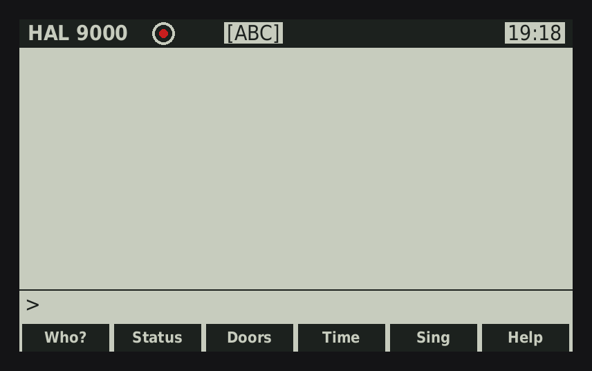

# HAL 9000 for the SwissMicros DM42



*Simulated DM42 screen with real replies from HAL (rendered by `docs/make_gif.py`).*

A tiny language model in a calculator. HAL greets you according to the DM42's
real-time clock, asks for your name, and then chats in a calm, polite, slightly
unsettling voice. It also solves arithmetic, tells the time and date, and sings
"Daisy Bell" on the buzzer.

Fan project. Not affiliated with SwissMicros or with the makers of *2001: A Space Odyssey*.

## Install

Download [`release/HAL9000.pgm`](release/HAL9000.pgm).

1. Connect the DM42 by USB. On the calculator, open **SETUP → System → Enter
   System Menu → Activate USB Disk** (on some firmware versions it is
   **SETUP → Activate USB Disk**).
Requires DMCP 3.26 or newer (shown under SETUP → System → About).

2. Copy `HAL9000.pgm` to the root of the calculator disk and eject it.
3. Open **SETUP → System → Enter System Menu → Load Program**, choose
   `HAL9000.pgm`, and confirm.
4. To go back to Free42, use **[SHIFT][0] (SETUP) → System → Load Program**
   and pick the DM42 firmware file (`DM42-x.y.pgm`) from the disk.
   If it isn't on the disk, download it from the SwissMicros website first.

HAL doesn't touch the QSPI flash, so the DM42 firmware's QSPI data stays intact.

## Keys

| Key | Action |
|---|---|
| Letter keys | Type the letter printed next to the key (A–Z) |
| `+` | space |
| `.` `0` `R/S` `−` | `.` `,` `?` `-` |
| `ENTER` | **send** your message |
| `←` | backspace |
| `EXIT` | clear the input line (also stops HAL in mid-sentence) |
| `▲` `▼` | scroll the conversation |
| `SHIFT` + key | one character from the other layout (e.g. `SHIFT 7` = 7) |
| `SHIFT` `ENTER` | lock the number layout on/off (`[123]` / `[ABC]` in the header) |
| `F1`…`F6` | quick questions: Who? / Status / Doors / Time / Sing / Help |
| `SHIFT` `F6` | sound on/off |
| `SHIFT` `0` | setup menu (set time and date, load another program) |
| `SHIFT` `EXIT` | power off |

The number layout has digits, `+ − × ÷` as `+ - * /`, and `( ) ^` on the
`Σ+`, `1/x` and `√x` keys. Example: type `12*(7+3)` and press `ENTER`.

The keymaps are the `ABC[]` and `NUM[]` tables at the top of
`src/dm42_main.c`. If a printed letter on your unit differs, edit the table
and rebuild.

## How it works

* **Rules** (`src/hal_core.c`) handle your name, greetings checked against the
  clock ("good evening" in the morning gets corrected), time, date,
  arithmetic, singing and the pod bay doors.
* **Live ship systems.** "Fuel", "battery" and "power" questions report the
  calculator's real supply voltage and whether USB ("the umbilical") is
  connected. "Memory" reports the real free RAM. "Status report" gives
  everything at once. The model can also use these values: it writes `#`
  for the voltage and `@` for free memory, and the calculator fills them in.
* Anything else goes to the **language model**: a character-level Llama-style
  transformer with 5 layers, 96 dimensions, 4 query heads and 1 shared KV head,
  a SwiGLU feed-forward layer of 288, and a 128-character context. It has about
  538K parameters, quantized to int8 in groups of 32 (≈610 KB in flash).
  Inference uses about 45 KB of RAM, including an int8 attention cache.
* The model was trained on an original synthetic HAL-style dialogue corpus
  (`train/gen_corpus.py`) covering 67 topics. They span ship systems (fuel,
  memory, life support, engines, navigation, comms, the AE-35 unit,
  hibernation, pods, alarms, diagnostics), the voyage (mission, Jupiter,
  Earth, Mission Control, the monolith, space, aliens), HAL himself (origin,
  his twin, living in a DM42, learning, fear, lying, consciousness), you
  (mood, work, hobbies, family, food, sleep, boredom) and everyday chat. In the corpus, `~` stands for the user's name, and
  the calculator fills in your name at runtime.

It is a very small model. It mostly recombines lines from its training set,
sometimes off-topic and sometimes with odd spelling. That's part of the charm.

## Rebuild

```sh
# 1. Model (needs Python + PyTorch; CPU is fine, ~10 min)
cd train
python3 gen_corpus.py corpus.txt 90000
python3 train.py train 6000          # writes ../src/hal_model.h (~25 min on CPU)

# 2. Try it on your PC
cd ../src
gcc -O2 -o hal_host hal_core.c host_main.c -lm && ./hal_host
HAL_HOUR=22 ./hal_host               # pretend it is evening

# 3. Calculator program (needs arm-none-eabi-gcc in PATH)
cd ../dm42
make                                 # -> build/HAL9000.pgm
```

The first `make` may stop with "QSPI contents changed. Run build once more".
That's normal: run `make` again.

To change HAL's personality, edit the lines in `train/gen_corpus.py` and
retrain. To change the fixed replies, edit `rules()` in `src/hal_core.c`.

## License

MIT for the HAL code, model and training scripts (see `LICENSE`). The SwissMicros DMCP SDK parts are BSD 3-Clause.

## Credits

* DMCP SDK © SwissMicros (BSD 3-Clause), in `dm42/dmcp`, `dm42/bin`, `src/menu.c`
* Inference design inspired by Andrej Karpathy's llama2.c (MIT)
* "Daisy Bell" by Harry Dacre (1892), public domain
